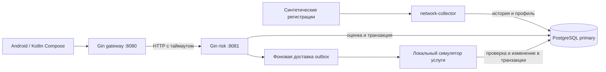

# Архитектура проекта и работа с навыками

Руководство для участника команды, который подключается к учебному проекту «Сессионный антифрод для “Мой МТС”». Описывает реализованный срез `protect-call-forwarding` и помогает выбрать рабочий процесс для следующего изменения.

Быстрый запуск и зависимости находятся в [README](../README.md), обязательные правила — в [AGENTS.md](../AGENTS.md), фактически выполненные проверки — в [отчёте](verification.md). Этот документ не меняет требования, статус ADR или продуктовую политику.

## 1. Что делает система

Система проверяет риск перед изменением синтетической переадресации. Сборщик получает моделируемые регистрации SIM, сохраняет историю и обновляет профиль аккаунта. Android-клиент запрашивает защищённое действие через шлюз. Скорер читает актуальное состояние, сохраняет решение и основания. Разрешённая операция попадает в outbox; фоновый исполнитель отдельно проверяет её актуальность и меняет серверное состояние услуги.

Сейчас поддерживаются аккаунты `demo-fraud`, `demo-legal`, `demo-clean` и назначения `sink-a`/`sink-b`. Реальные номера, данные абонентов, операторские сети и секреты исключены. Аттестация `demo-valid` и подтверждение `demo-approved` — тестовые подстановки.



Worker и симулятор — части процесса risk. Отдельного сервиса владельца услуги в демо нет. Синтетический источник встроен в сборщик; подключения к сети оператора нет.

## 2. Карта кода

| Место | Ответственность | Когда читать или менять |
|---|---|---|
| [cmd/gateway](../cmd/gateway/main.go) | Запуск внешнего API | Адрес шлюза, соединение со скорером |
| [cmd/risk](../cmd/risk/main.go) | Запуск скорера, Goose, доставка outbox | Жизненный цикл процесса, миграции, фоновые задачи |
| [cmd/network-collector](../cmd/network-collector/main.go) | Запуск синтетического источника, загрузка JSON | Новые входные сценарии |
| [internal/transport](../internal/transport/http.go) | Gin-обработчики, проверка OpenAPI, HTTP-вызов скорера | Ошибки HTTP, лимиты, таймауты |
| [internal/core/service.go](../internal/core/service.go) | Evaluate, Confirm, Hold, Deliver, транзакции | Изменение защитного поведения и исполнения |
| [internal/core/collector.go](../internal/core/collector.go) | Приём регистраций, профиль, переоценка | Источники, порядок и опоздание сигналов |
| [internal/policy](../internal/policy/policy.go) | Расчёт признаков и детерминированная реакция | Сочетания сигналов и демо-политика |
| [db/queries](../db/queries/core.sql) | Исходный SQL для sqlc | Изменение запросов |
| [db/migrations](../db/migrations) | Goose: таблицы, ограничения, роли | Изменение схемы и прав |
| [contracts](../contracts) и [scripts/contracts.py](../scripts/contracts.py) | OpenAPI двух API и источник схем | Изменение входных/выходных данных |
| [internal/api](../internal/api) и [internal/store](../internal/store) | Генерируемые типы, роутеры и SQL-обвязка | Читать для понимания; менять через генерацию |
| [apps/mobile](../apps/mobile) | Compose-экран и HTTP-клиент | Мобильный сценарий, показ подтверждения и результата |
| [tests/integration_test.go](../tests/integration_test.go) | Проверки на PostgreSQL и через HTTP | Доказательство целостности сквозного поведения |
| [openspec](../openspec) | Предложения, сценарии, проектные решения и задачи | Новое поведение и его согласование |
| [.agents/skills](../.agents/skills) | Локальные инструкции для типовых задач | Выбор навыка под конкретную работу |

Go-модуль один. `pgxpool` управляет соединениями, sqlc генерирует доступ к SQL, Goose применяет миграции. HTTP-обвязка и типы генерируются oapi-codegen. Прикладные решения остаются в core/policy, а не в HTTP-обработчиках.

## 3. Путь одного действия и данные

1. Collector сохраняет время возникновения и время получения регистрации. Повтор определяется по идентичности события; другое содержимое под прежним ID отклоняется.
2. По двум последним регистрациям по времени события формируется профиль: SIM, перемещение, источник, времена. Отсутствующий сигнал сохраняется как неизвестный, а не `false`.
3. `POST /v1/evaluate` проходит через gateway к risk. Шлюз ограничивает ожидание скорера 1,5 секунды. Ошибка скорера не даёт разрешения на изменение услуги.
4. Risk блокирует строку защиты аккаунта, проверяет привязку операции, читает профиль, рассчитывает признаки и применяет политику.
5. Решение, снимок оснований, аудит и при `allow` намерение исполнения записываются одной транзакцией. При `step_up` создаётся одноразовое подтверждение.
6. `POST /v1/confirm` проверяет тестовое подтверждение и атомарно расходует его. При успехе сохраняются новое решение `allow` и outbox.
7. После коммита исполнитель повторно проверяет разрешение и записывает фактический результат. `GET /v1/state/{account}` позволяет увидеть услугу, решения и аудит.

| Группа таблиц | Что сохраняется |
|---|---|
| `account_guard`, `subscriber_profile` | Текущая ревизия защиты, охлаждение и профиль |
| `event_receipt`, `sim_registration` | Дедупликация, исходные регистрации и оба времени |
| `operation`, `policy_version`, `risk_decision` | Неизменяемая привязка операции, версия политики, решения и evidence |
| `operation_confirmation` | Привязка, срок и расход одноразового подтверждения |
| `execution_outbox`, `execution_result` | Намерение доставки и отдельный факт исполнения/отклонения |
| `service_state`, `audit_event` | Состояние услуги и последовательность действий |

Для нового принятого сетевого сигнала увеличивается ревизия защиты. Если у аккаунта уже есть решение, выполняется переоценка последней операции с `supersedes_decision_id`. Старое решение и его evidence не переписываются. Автоматический откат уже выполненного изменения услуги не заявлен.

### Почему проверка разрешения и запись услуги не разнесены

Единая точка упорядочения — `SELECT ... FROM account_guard ... FOR UPDATE`. Ingest, оценка, запрет, расход подтверждения и исполнение используют одну блокировку аккаунта.

При доставке команды симулятор в одной транзакции сверяет аккаунт, ID и тип операции, хеш параметров, срок, ревизию и ограничения, затем меняет услугу и пишет результат с аудитом. Если запрет получил блокировку первым, старое разрешение отклоняется. Если исполнение получило её первым, оно завершается до установки запрета. Повтор `command_id` не повторяет эффект.

Эта гарантия действует для локальной модели с общей БД. Вынос услуги в отдельный сервис требует согласованного протокола с её владельцем; простого дополнительного HTTP-вызова недостаточно. Подробности — [OpenSpec design](../openspec/changes/protect-call-forwarding/design.md).

## 4. Политика, источники и границы демо

`demo-v1` использует три реакции: низкий риск → `allow`, средний → `step_up`, высокий → `hold`. Неизвестный или устаревший обязательный сигнал приводит к приостановке. Охлаждение длится 5 минут, разрешение и подтверждение — 2 минуты; свежесть и пороги являются учебными допущениями. Истечение охлаждения обрабатывается при следующей транзакции аккаунта; новое опасное сочетание может снова вызвать `hold`.

В C4 мошеннику завершают сессию, а законную замену SIM при среднем риске пропускают. Для демо выбрано поведение по М-01: охлаждение и дополнительное подтверждение. Фактическую политику согласуют команда и ментор; см. [таблицу расхождений](discrepancies.md).

При обсуждении изменения используй следующую цепочку источников:

| Источник | Зачем нужен |
|---|---|
| Исходные М-01 и C4 в корне | Цель проекта, пользовательские сценарии, контекст |
| [ADR-007, извлечённый текст](sources/ADR-007.txt) и исходный DOCX | Принятая для учебного проекта архитектура хранения и инварианты |
| [Исходные требования](sources/requirements.json) из XLSX | Сохранённые REQ-ID и проверяемые формулировки |
| [Матрица трассировки](traceability.md) | Что покрывает текущий срез, чем проверяется, что отложено |
| [ADR-008](adr/ADR-008-stack.md) | Технический выбор стека |
| [OpenSpec change](../openspec/changes/protect-call-forwarding) | Предложение, сценарии приёмки, design и задачи текущего изменения |

Противоречия фиксируются явно, а не разрешаются молчаливым переименованием REQ-ID или изменением статуса ADR-007.

Локально работает один PostgreSQL. Приёмочный контур ADR-007 предусматривает primary, два HA standby и отдельную асинхронную аналитическую реплику. ML, ZEN, реальные Play Integrity/passkey/recovery, автоматическое управление сроками хранения и HA пока не реализованы. [Профиль нагрузки](load/README.md) отделяет будущую приёмку от локального smoke.

## 5. Как выбирать навык

Выбирай навык по задаче, затем читай его `SKILL.md`. Ссылки ниже ведут на файлы в этом репозитории. Наличие навыка в каталоге ещё не доказывает готовность его зависимостей в окружении. Для сторонних навыков проверь источник, версию/хеш в [skills-lock.json](../skills-lock.json) и необходимые инструменты до использования.

В примерах `$имя-навыка` обозначает явный запрос на его применение. Если имя не отображается в интерфейсе агента, укажи полный путь к соответствующему `SKILL.md`. Команды с `$имя-навыка` — текст запроса агенту, а не команды PowerShell.

| Ситуация | Навык / рабочий процесс | Ожидаемый результат |
|---|---|---|
| Ещё не ясно, что именно строить | [openspec-explore](../.agents/skills/openspec-explore/SKILL.md) | Разобранные варианты и вопросы, без реализации |
| Нужно предложить новую возможность | [openspec-propose](../.agents/skills/openspec-propose/SKILL.md) | Proposal, delta spec, design и tasks |
| Решения изменились в существующем плане | [openspec-update-change](../.agents/skills/openspec-update-change/SKILL.md) | Согласованные между собой артефакты, без правки кода |
| План готов к реализации | [openspec-apply-change](../.agents/skills/openspec-apply-change/SKILL.md) | Код и проверки по задачам изменения |
| Новый мошеннический или законный контрольный сценарий | [add-fraud-scenario](../.agents/skills/add-fraud-scenario/SKILL.md) | Синтетический сигнал → решение → проверка состояния услуги |
| Ошибка или регрессия с неизвестной причиной | [diagnosing-bugs](../.agents/skills/diagnosing-bugs/SKILL.md) | Воспроизведение, проверенная причина, узкое исправление |
| Ошибка разобрана и нужен устойчивый урок | [learn-from-failure](../.agents/skills/learn-from-failure/SKILL.md) | Регрессионный тест, уточнение контракта или инструкции для ревью |
| Нужна реализация через тесты | [tdd](../.agents/skills/tdd/SKILL.md) | Наблюдаемое поведение проверено циклом red → green → refactor |
| Спор о политике или границе ответственности | [grill-with-docs, процесс команды](grill-with-docs.md) | Аргументы из документов, контрпримеры, решение команды |
| Нужны новые термины или ADR | [domain-modeling](../.agents/skills/domain-modeling/SKILL.md) | Ясные определения и явно записанное решение |
| Нужно улучшить интерфейс модуля | [codebase-design](../.agents/skills/codebase-design/SKILL.md) | Обоснованная граница и малый понятный интерфейс |
| Нужно проверить идею интерфейса/состояний | [prototype](../.agents/skills/prototype/SKILL.md) | Одноразовый эксперимент с конкретным вопросом |
| Требуются внешние технические факты | [research](../.agents/skills/research/SKILL.md) | Markdown-исследование по первичным источникам |
| Код готов к независимому ревью | [code-review](../.agents/skills/code-review/SKILL.md) | Замечания отдельно по стандартам репозитория и требованиям |
| Нужен текст PR | [pr](../.agents/skills/pr/SKILL.md) и [шаблон проекта](../.github/pull_request_template.md) | Проблема, новое поведение, REQ-ID и доказательства |
| Меняются инструкции агента | [writing-for-agents](../.agents/skills/writing-for-agents/SKILL.md) | Короткие инструкции с точными условиями и критериями готовности |

`code-review` предусматривает параллельные проверки двумя агентами, `research` — фоновое исследование. Это особенности самих навыков; доступность делегирования нужно учитывать в выбранном окружении. Для обычной небольшой правки отдельные агенты не обязательны.

## 6. Практические сценарии работы

### Новый участник: запустить и понять демо

Прочитай README, корневой AGENTS и этот документ. Для Android дополнительно прочитай [локальные инструкции](../apps/mobile/AGENTS.md). Проверь `git status` и сохрани существующие изменения команды.

На Windows с установленным PostgreSQL 18:

```powershell
.\scripts\local-demo.ps1
python scripts/demo.py --scenario fraud
python scripts/demo.py --scenario legal
```

С Docker: `make demo`. Ожидаемый результат — fraud не меняет услугу; legal сначала получает step_up и после тестового подтверждения меняет её один раз на новую операцию. Это критерий рабочего запуска, а не только успешный старт процессов.

### Добавить антифрод-сценарий

Пример запроса агенту:

> Примени $add-fraud-scenario: добавь законный контрольный случай повторной регистрации той же SIM без смены устройства. Сохрани unknown отдельно от false. Проверь решение, серверное состояние услуги и аудит. Свяжи проверку с REQ-F01/F03/F07/F11.

Ожидаемый путь: синтетические события в Fixtures или JSON для collector → признаки → реакция → PostgreSQL/HTTP-тест. Если сценарий требует новой продуктовой политики, сначала зафиксируй допущение и проведи обсуждение по grill-with-docs. Готовность — новый тест и существующие контрольные сценарии проходят, трассировка обновлена.

### Исправить сбой

> Примени $diagnosing-bugs: повтор одной команды иногда увеличивает changes дважды. Сначала воспроизведи проблему на изолированном PostgreSQL и найди причину; затем добавь регрессионную проверку.

После установления причины используй `learn-from-failure`, чтобы сохранить урок в правильном месте. Ошибку идемпотентности закрепляют тестом поведения; неоднозначный формат — контрактом; ошибочный рабочий процесс — инструкцией. Критерий готовности: исходное воспроизведение перестало падать, регрессионная проверка проходит, временная диагностика убрана.

### Спланировать новую возможность

Для новой возможности используй последовательность: explore при необходимости → propose → ревью плана → отдельный запрос apply. `openspec-propose` создаёт план; `openspec-update-change` меняет план; реализация относится к `openspec-apply-change`.

> Примени $openspec-propose для protect-recovery-contact: опиши серверную защиту изменения контакта восстановления, привязку разрешения, сценарии гонок и REQ-ID. Открытые продуктовые решения перечисли отдельно.

После ревью:

> Примени $openspec-apply-change для protect-recovery-contact. Выполни согласованные задачи и проверки; незакрытые решения не подменяй готовой реализацией.

Пример обозначает будущую возможность, а не уже существующий change. Текущий `protect-call-forwarding` содержит отдельный раздел будущих задач; их нельзя помечать завершёнными по результатам локального демо.

### Изменить API или базу данных

Сначала опиши новое наблюдаемое поведение и связанные REQ-ID. При изменении хранения/исполнения прочитай ADR-007 и design текущего change. Новый SQL оформляй Goose-миграцией; уже применённую миграцию сохраняй. Меняй запросы в db/queries и схемы в scripts/contracts.py, затем запускай генерацию.

```powershell
.\scripts\dev.ps1 generate
python scripts/verify_generated.py
.\scripts\dev.ps1 check
$env:TEST_DATABASE_URL='postgres://demo@127.0.0.1:55432/postgres?sslmode=disable'
.\scripts\dev.ps1 e2e
```

Последний URL подходит к локальному кластеру из local-demo. У Compose другой порт и пароль — см. README. Для миграции проверь чистое применение, откат/повторное применение и сохранность существующих данных, если они затронуты. Генерируемые Go-файлы не являются местом ручного исправления.

### Изменить Android-сценарий

Опиши экран, действие, загрузку, ошибку и серверный результат. Для обсуждения UX допустим отдельный prototype; он не заменяет рабочий Compose-клиент. Реальные подтверждения и аттестацию проектируй отдельным OpenSpec change с рассмотрением восстановления доступа.

```powershell
.\scripts\dev.ps1 android
adb install -r apps/mobile/app/build/outputs/apk/debug/app-debug.apk
```

Для эмулятора используй `http://10.0.2.2:8080`, для устройства через `adb reverse tcp:8080 tcp:8080` — `http://127.0.0.1:8080`. Сборка доказывает компилируемость. Визуальная приёмка, поведение на устройстве и Play Integrity требуют отдельных проверок.

### Провести ревью и завершить изменение

> Примени $code-review к текущим изменениям относительно HEAD. Проверь соблюдение AGENTS, соответствие OpenSpec/REQ-ID, границу транзакции, неизвестные сигналы, гонки и повторы. Только замечания с местом и воспроизводимым последствием.

Указывай базу сравнения и включай новые неотслеживаемые файлы в область ревью: один `git diff` их не показывает. После исправлений приложи команды и фактические результаты через навык pr и шаблон репозитория. Запись «тесты должны пройти» не заменяет выполненную проверку.

Для завершённого OpenSpec change существуют [sync-specs](../.agents/skills/openspec-sync-specs/SKILL.md) и [archive-change](../.agents/skills/openspec-archive-change/SKILL.md): первый переносит delta-требования в основные спецификации, второй завершает жизненный цикл изменения. Архивация текущего change требует явного разбора оставшихся будущих задач и решения команды.

### Запустить проверку безопасности или нагрузки

Для безопасности заранее задай область, модель угроз и границы изолированного стенда. Наличие отчёта и статус завершения важнее пустого списка находок. При сбое внешнего сканера сначала сохрани статус/логи и диагностируй инструмент; это не основание объявлять проект безопасным или менять защитную политику.

Для производительности начни с [профиля ADR-007](load/profile.json) и [методики](load/README.md). Полная цель — p99 ≤ 200мс при совместных потоках и 10-минутном всплеске. Последовательный `scripts/latency.py` — только smoke. Навык research помогает собрать методику по первичным источникам, но не заменяет сам измеренный прогон. HA и физическое устройство отмечай отдельными видами проверки.

## 7. Минимум доказательств перед передачей на ревью

| Что изменилось | Что приложить |
|---|---|
| Go-поведение | `dev.ps1 check` / `make check` и соответствующий сценарий |
| Транзакции, SQL, подтверждения, outbox | Integration на PostgreSQL с состоянием услуги и аудитом |
| Контракты или SQL-источники | Генерацию и нулевое расхождение при повторной генерации |
| Android | assembleDebug; при изменении UX — результат проверки на эмуляторе/устройстве |
| Требования или политика | REQ-ID, обновлённую трассировку, OpenSpec/ADR и статус согласования |
| Только документация | Проверенные ссылки, пути, команды и соответствие текущему коду |

В итоговом описании разделяй: что реализовано, что реально запущено, что не проверялось и почему, что требует решения команды. Ограничения исходных данных и локального стенда сохраняются при любом выбранном навыке.
