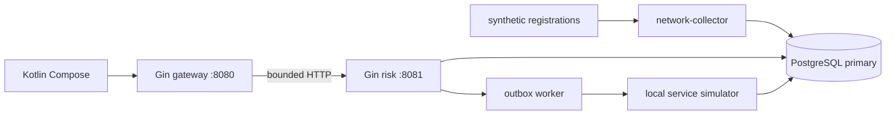

# Архитектура стенда

Предоставленная C4: [контекст](../../C4_1_контекст.png), [контейнеры](../../C4_2_контейнеры.png), [мошенник](../../C4_3_сценарий_мошенник.png), [абонент](../../C4_4_сценарий_абонент.png). Динамика и пороги — черновик, сопоставление в [расхождениях](../discrepancies.md).

Сервис оценки владеет границей транзакции. Основной ключ — стабильный demo-account, не номер; симулятор не содержит MSISDN. История — event_receipt + sim_registration; профиль — subscriber_profile; разрешение — risk_decision; одноразовое состояние — operation_confirmation; доставка — execution_outbox; факт — execution_result + audit_event; услуга — service_state. Разрешение не равно исполнению. См. точку упорядочения в [OpenSpec design](../../openspec/changes/protect-call-forwarding/design.md).

Поздний сигнал увеличивает ревизию и порождает новое решение со ссылкой. Профиль строится по времени события, не времени доставки. История решений и основания append-only, снимок самодостаточен после будущей очистки регистраций. Общая identity сети — (sim_id,cell_id,event_time), источник+event_id защищены hash от несовместимого replay. Первое наблюдение не доказывает отсутствие смены SIM.

В учебной реализации одна операция — protect-call-forwarding, target из sink-a/sink-b. SIM-регистрации и аттестация синтетические. USSD, кол-центр, настоящий операторский сервис и остальные операции не подключены (REQ-F29).

Приёмочный контур ADR-007: P + S1/S2 на независимых узлах/дисках, отдельная A async для расследований. synchronous_standby_names='ANY 1 (s1,s2)', synchronous_commit=on, fsync=on. Внешний HA-controller с fencing исключает split brain и выбирает только кандидата со всеми подтверждёнными записями. A не участвует в критичном подтверждении и автоматическом failover. При отсутствии синхронного сохранения чувствительные действия останавливаются. Оперативные чтения только P. Оркестратор, оборудование, backup/WAL и восстановление площадки ещё не согласованы.

Цели HA: отказ одного P/S1/S2 — RPO=0, RTO≤5мин; A lag≤5мин, расследование≤5с, 90-дневный прогон≤1ч. Локальный Compose их не проверяет. Сроки ADR: события 90д, raw регистрации 30д от получения, решения/основания 1год, ограничения минимум 1год после завершения; активные запреты удерживаются. В демо очистка выключена, production partition/lifecycle требуют отдельной приёмки. Рабочие подключения делают SET ROLE antifraud_runtime: SELECT/INSERT по нужным таблицам и UPDATE только проекций/подтверждений/outbox/услуги. TestRuntimeRoleACL проверяет запрет изменения/удаления истории, TRUNCATE и отключения триггеров. Мигратор владеет схемой; production разделение login-учёток и секретов ещё не подключено. Владелец/администратор БД вне этой защиты.
