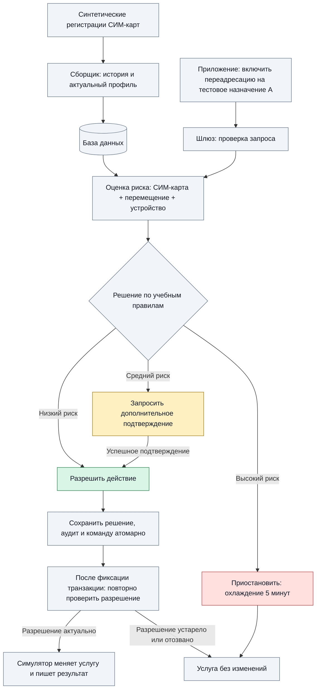

# Сессионный антифрод — платформа за минуту

**Задача:** не дать захватившему аккаунт включить переадресацию. Перед изменением услуги сервер сопоставляет сетевые сигналы и контекст устройства, затем разрешает действие, требует подтверждение или приостанавливает его.

## Как проходит действие

Все решения, включая приостановку и запрос подтверждения, сохраняются с основаниями и журналом действий. Команда исполнения создаётся только при разрешении.

## Что видно в приложении

| Сценарий | Что обнаружено | Реакция | Результат на чистом стенде |
|---|---|---|---|
| 🔴 Подозрительная операция | Новая СИМ-карта, новое устройство, Калининград → Владивосток | Приостановка | Переадресация отключена, изменений **0** |
| 🟡 → 🟢 Законная операция | Новая СИМ-карта, знакомое устройство, Калининград → Светлогорск | Запрос подтверждения → тестовое подтверждение → разрешение | Тестовое назначение А, изменений **1** |

**Разрешение ≠ исполнение:** после получения разрешения приложение отдельно запрашивает состояние услуги и показывает фактический результат.

## Основные решения и зачем они нужны

| Решение | Какую проблему решает |
|---|---|
| **Один защищённый сценарий — переадресация** | Позволяет проверить полный путь от сигнала до изменения услуги. |
| **Явные учебные правила, признаки отдельно от правил реагирования** | Причину реакции можно объяснить; версию и снимок оснований сохраняем для разбора. |
| **Неизвестный или устаревший сигнал → приостановка** | Отсутствие данных не становится разрешением. Ошибка модуля оценки риска также не меняет услугу. |
| **Единая база данных и общая блокировка защиты аккаунта** | Запрет, оценка, подтверждение и исполнение упорядочены по аккаунту; старое разрешение не обходит уже установленный запрет. |
| **Решение + журнал действий + очередь исходящих команд в одной транзакции** | Команда не теряется между сохранением решения и доставкой; доставка начинается после фиксации транзакции. |
| **Проверка разрешения при исполнении и защита от повторов** | Проверяем срок, ревизию и параметры операции; повтор одной команды не меняет услугу второй раз. |
| **Одноразовое подтверждение конкретного действия** | Подтверждение привязано к аккаунту, операции и назначению; расходуется атомарно. Разрешение и подтверждение действуют 2 минуты. |
| **Неизменяемая история решений и исполнения** | Поздний сигнал вызывает новую оценку; прежние основания остаются доступны для расследования. |
| **Мобильное приложение, сервер и формальные описания интерфейсов** | Простой пользовательский сценарий, проверка формата запросов, типизированный доступ к данным и управление версиями схемы базы. |

> **Границы демонстрации.** Только учебные аккаунты, СИМ-карты, назначения и синтетические сигналы. Проверка подлинности устройства и подтверждение действия заменены тестовыми подстановками. Услуга моделируется локально в общей базе данных; отдельный сервис услуги, реальная проверка подлинности устройства, независимое подтверждение и высокая доступность требуют следующего этапа. Пороги и сроки — учебные допущения, требующие согласования.

Основания: [архитектура](architecture-and-workflows.md), [проектные решения](../openspec/changes/protect-call-forwarding/design.md), [архитектурное решение № 007](sources/ADR-007.txt), [расхождения источников](discrepancies.md).
